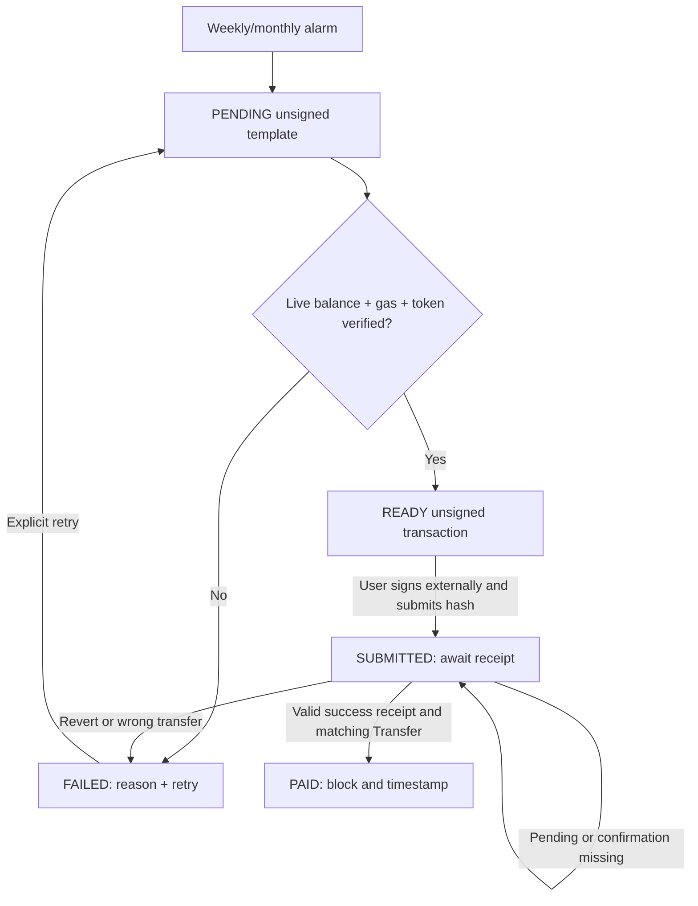

# Recurring Payment Agent — Pharos Agent Arena

**Deployment update:** The linked Cloudflare Worker has passed a [real production end-to-end verification](https://github.com/trantanlong2411-droid/Recurring-Payment-Agent/actions/runs/41683036544): UTC due period created once, unsigned USDC preparation from actual Pharos balances, unknown hash remains SUBMITTED, insufficient balance becomes FAILED, retry stays within the same period. No funds were transferred. Unit/build tests also passed.

**Medium / Payments (100 points + optional video bonus)**

- **Public application / Proof Link:** https://recurring-payment-agent.trantanlong2411.workers.dev/
- **Repository:** https://github.com/trantanlong2411-droid/Recurring-Payment-Agent
- **Automated tests:** https://github.com/trantanlong2411-droid/Recurring-Payment-Agent/actions
- **Chain:** Pharos Pacific Mainnet (chain ID 1672), fixed RPC `https://rpc.pharos.xyz`

Recurring Payment Agent schedules rent, subscriptions or payroll-style on-chain payments using **Cloudflare Workers + a SQLite-backed Durable Object and its background alarm**. It automatically creates a unique **unsigned payment instruction** on each due date. The user must review, sign and send it with a wallet they actually control. No server code can sign or broadcast transfers.

## Task rubric and actual behavior

| Required criterion | How it is implemented |
| --- | --- |
| 1. Weekly/monthly schedule, amount/token/recipient | `POST /api/schedule` with `action=create` stores UTC recurrence, public sender, recipient, token, amount and a private capability key. Monthly dates honor the original target day (January 31 → February 28 → March 31). |
| 2. Prepares each period on time and tracks paid/pending/failed | Each Durable Object uses `setAlarm(nextDueAt)` to generate a uniquely keyed **PENDING** period and ABI-encoded unsigned template, even when the browser is closed. On demand, it validates live USDC or PROS balance and gas, creating **READY** or **FAILED**. A submitted hash becomes **SUBMITTED**, then only a verified matching, successful on-chain receipt becomes **PAID**. |
| 3. Insufficient balance or failure without double-paying | No unsigned draft with inadequate balance, gas or invalid contract. Failed periods have a controlled retry. A period does not accept a second hash while submitted or after paid. Hashes are unique within a schedule; alarm processing is idempotent despite retries. |
| 4. History and next payment | Full UTC schedule history and status table, nextDueAt shown on the dashboard and returned by the API. History persists in SQLite Durable Object storage. |

**Important limitation:** The app prevents duplicate preparation and duplicate transaction hash acceptance **within the same schedule**. It cannot stop someone from independently signing multiple transfers in a separate wallet or reusing a hash across unrelated schedules. That stronger guarantee requires a dedicated on-chain payment contract with period identifiers. We do not claim otherwise.

## Run the reviewer demo

1. Open [the Worker](https://recurring-payment-agent.trantanlong2411.workers.dev/) and select **Quick demo: first payment due in 20 seconds**.
2. Use the prefilled **public third-party sender** and an example recipient, select USDC amount 1.00, choose weekly or monthly, and click **Create recurring schedule**.
3. Save the private **schedule access key** (random UUIDv4); it is stored in this browser for convenience. Only users possessing this key may manage the schedule. Treat it like an access password.
4. After the due time, click **Refresh now**. The alarm (or a due check on refresh) creates **exactly one PENDING** period. Refresh again to see that no duplicate appears.
5. Click **Inspect → Check balance & prepare unsigned**. The application verifies mainnet 1672, deployed Circle USDC contract and symbol/decimals, live sender balance, native PROS gas and nonce. With enough funds the period becomes **READY**, with actual calldata and unsigned transaction JSON; with insufficient balance the period becomes **FAILED**, and the Retry button is available.
6. **No signing or sending is needed for this task demo.** Download the unsigned JSON. If a user really sends from their own wallet externally, they may submit its **real transaction hash** to the Worker. Pending, revert and verified-paid paths then display accurate on-chain status. The app will not mark a fake hash Paid.

For safety, do not send real money to the example recipient. The public sender belongs to an unrelated third party. The app does not own it, and it cannot spend those funds.

## Architecture

- `src/page.mjs` — responsive dashboard and UTC payment history; browser saves only the random schedule access key.
- `src/logic.mjs` — validated cadence, UTC dates, month-end handling, unique payment-period construction, ABI-encoded unsigned templates.
- `src/chain.mjs` — **read-only** Pharos JSON-RPC for verified balances, nonce, gas estimates, receipt and Transfer events.
- `src/worker.mjs` — Cloudflare Worker router and `PaymentSchedule` Durable Object with **SQLite** document storage, alarms, idempotent due processing and payment status transitions.
- `tests/logic.test.mjs` — all four rubric categories, monthly/weekly logic, no duplicate period, transaction matching.
- `scripts/smoke-deployed.mjs` — production Worker end-to-end reviewer proof, when Worker is deployed.

SQLite Durable Objects are created automatically with the Wrangler `new_sqlite_classes` migration in `wrangler.jsonc`. There is no manual D1 database creation and no external signing bot. Each schedule is stored in its own Durable Object, addressed by a high-entropy browser-generated capability key.

## State machine



Each due period is keyed by its scheduled UTC timestamp. One alarm may run more than once (Cloudflare alarms are **at-least-once**); creating the same period twice is forbidden. A single alarm per Durable Object is rearmed for the next date or pending receipt checks.

### Security and evidence integrity

- **No private keys, seed phrases, wallet signing or transaction broadcast.**
- Only known assets: Circle USDC at `0xC879C018dB60520F4355C26eD1a6D572cdAC1815` (6 decimals) and native PROS.
- For paid USDC: verifies chain 1672, transaction success, sender, token contract, exact ABI calldata and matching receipt Transfer(from,to,amount), plus one confirmation. For PROS: verifies sender/recipient, native amount and empty calldata.
- An external transaction can be outstanding for some time. **SUBMITTED is not PAID.**
- Token and gas balance and nonce are checked fresh at draft preparation, not guaranteed at future execution.
- Your access key is a capability rather than wallet authentication. Anyone with it can pause/cancel or manage the schedule, so keep it private. No multi-user email login is claimed.
- The example account's public balance can change and is **never** treated as an authorization.
- No invented `PAID` state or fake transaction hashes.

## Develop and deploy

```sh
npm install
npm test
npm run build
npx wrangler deploy
```

If the linked Cloudflare Worker has a different actual name, change `name` in `wrangler.jsonc` to match the linked Worker before deploying. Check that it serves `GET /api/health`. Cloudflare Builds should use deployment command `npx wrangler deploy` and root `/`.

## References

- [Pharos network documentation](https://docs.pharos.xyz/getting-started/network)
- [Circle official USDC on Pharos](https://www.circle.com/multi-chain-usdc/pharos)
- [Cloudflare Durable Objects SQLite](https://developers.cloudflare.com/durable-objects/best-practices/access-durable-objects-storage/)
- [Cloudflare Durable Objects alarms](https://developers.cloudflare.com/durable-objects/api/alarms/)
- [ERC-20 token standard](https://eips.ethereum.org/EIPS/eip-20)

**Reviewer submission:** use the public Worker home page as **Proof Link** (no separate Proof page needed) and this repository as Repo Link. A working preview and independent successful CI checks are required before claiming the task is ready for submission.
